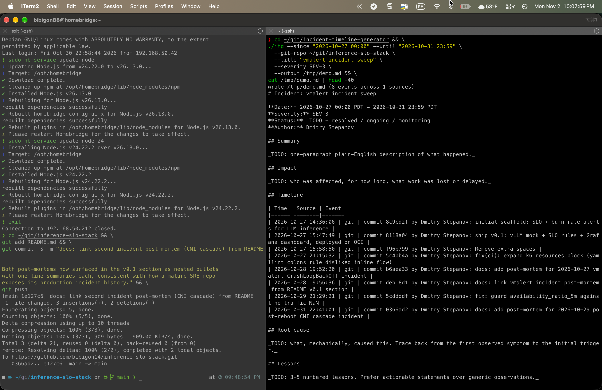

# incident-timeline-generator

[](https://github.com/bibigon14/incident-timeline-generator/actions/workflows/ci.yml)
[](https://github.com/bibigon14/incident-timeline-generator/actions/workflows/release.yml)
[](https://goreportcard.com/report/github.com/bibigon14/incident-timeline-generator)
[](https://opensource.org/licenses/MIT)

Generates a Markdown post-mortem skeleton from the raw signals you already
have during an incident: Kubernetes events, Prometheus alerts, git
commits, and systemd journal entries. Takes a time window, pulls from
each source, merges by timestamp, renders into the standard post-mortem
shape you'd otherwise type by hand.

Built because I noticed I was reconstructing incident timelines manually
across two production post-mortems last week - the same mechanical
assembly of "kubectl events sorted by time" + "prometheus alerts fired"
+ "git commits deployed around the window" + "grep through journalctl".
This tool does the first draft so the human can focus on root cause and
lessons.

## What it does

```
   kubectl events ──┐
                    │
   prometheus       │
   alerts           ├─► merge by timestamp ─► markdown skeleton
                    │                           - Summary (empty)
   git commits      │                           - Timeline table (populated)
                    │                           - Root cause (empty)
   journalctl ──────┘                           - Lessons (empty)
                                                - Follow-up (empty)
```

The automation stops at the mechanical step. Root cause analysis and
lessons stay human - the tool just removes the typing.

## Live demo



Real run against the git history of the sibling
[inference-slo-stack](https://github.com/bibigon14/inference-slo-stack)
repo over the window of its two production incidents (2026-10-27 vmalert
CrashLoopBackOff, 2026-10-29 post-reboot CNI cascade). Eight commits
captured into a merged Markdown table, Root cause / Lessons / Follow-up
left blank for the human. The tool stops where the typing stops.

## Install

### Pre-built binary (recommended)

Download from the [latest release](https://github.com/bibigon14/incident-timeline-generator/releases/latest)
for your platform (linux/darwin, amd64/arm64):

```bash
# Example for linux/amd64 - replace in URL for your platform
VERSION=0.2.0
curl -sSL "https://github.com/bibigon14/incident-timeline-generator/releases/download/v${VERSION}/itg_${VERSION}_linux_x86_64.tar.gz" \
  | tar xz -C /tmp
sudo install -m 0755 /tmp/itg /usr/local/bin/itg
itg -version
```

### From source

```bash
go install github.com/bibigon14/incident-timeline-generator/cmd/itg@latest
```

Or build locally:

```bash
git clone https://github.com/bibigon14/incident-timeline-generator
cd incident-timeline-generator
make build
```

## Usage

```bash
itg \
  --since "2026-10-29 03:00" \
  --until "2026-10-29 06:00" \
  --kubectl-namespace vm \
  --prometheus-url http://localhost:8429 \
  --git-repo ~/git/inference-slo-stack \
  --journalctl --journalctl-unit "k3s,containerd" --journalctl-priority 4 \
  --title "post-reboot CNI cascade" \
  --severity SEV-3 \
  --output docs/incidents/2026-10-29-post-reboot-cni-cascade.md
```

What this does:

1. Runs `kubectl -n vm get events` and filters to the window
2. Queries `prometheus-url/api/v1/query_range` for `ALERTS{alertstate="firing"}` transitions
3. Runs `git -C <repo> log --since=... --until=...` for commits in the window
4. Runs `journalctl -o json --since=... --until=... --unit=k3s --unit=containerd --priority=4`
5. Merges all four by timestamp and renders markdown with a header
   pre-filled, the timeline populated, and Root cause / Lessons /
   Follow-up left blank for the human

## Sources

Each source is an optional ingester. The tool runs whatever you point at
and skips the rest.

| Source | Flag | What it ingests |
|--------|------|------------------|
| Kubernetes events | `--kubectl-namespace` (or `--all-namespaces`) | `kubectl get events` for the window |
| Prometheus alerts | `--prometheus-url` | `ALERTS{alertstate="firing"}` transitions via `/api/v1/query_range` |
| git commits | `--git-repo` | commits in the window across all branches |
| systemd journal | `--journalctl` | `journalctl -o json` on the local host, optional unit / priority filter |

Future ingesters planned for v0.3:
- Loki log excerpts around critical events
- Grafana dashboard snapshots (via API)
- Prometheus bearer-token auth

## Output template

The rendered markdown follows the shape of the two post-mortems in
[inference-slo-stack/docs/incidents/](https://github.com/bibigon14/inference-slo-stack/tree/main/docs/incidents),
because that's the shape I was tired of typing:

```
# Incident: <title>

**Date:** <from --since> → <to --until>
**Severity:** <--severity>
**Status:** <blank, for human>
**Author:** <--author or git config user.name>

## Summary

<blank, for human>

## Impact

<blank, for human>

## Timeline

| Time | Source | Event |
|------|--------|-------|
| ... (populated from merged ingesters) |

## Root cause

<blank, for human>

## Lessons

<blank, for human>

## Follow-up actions

<blank, for human>
```

See [examples/sample-output.md](examples/sample-output.md) for a real
rendered skeleton from the 2026-10-27 vmalert incident.

## Why not <existing tool>

- **blameless, Rootly, FireHydrant, PagerDuty** - all great SaaS, all
  presume you're already paying for them. This is for homelab and small
  SRE teams who want the output artifact without the SaaS.
- **k8s-event-logger / prom2log** - these transform events, don't
  structure them into a post-mortem shape.
- **Writing it by hand** - works, but the mechanical ingestion step is
  typing, not thinking.

## Status

v0.2 - four working ingesters (kubectl, prometheus, git, journalctl),
cross-platform binaries published via goreleaser (linux/darwin,
amd64/arm64). Known gaps:
- No log excerpt ingester yet (coming v0.3)
- Prometheus auth not supported (bearer token only in v0.3)
- Hardcoded to GET events; no watch mode

## License

MIT
